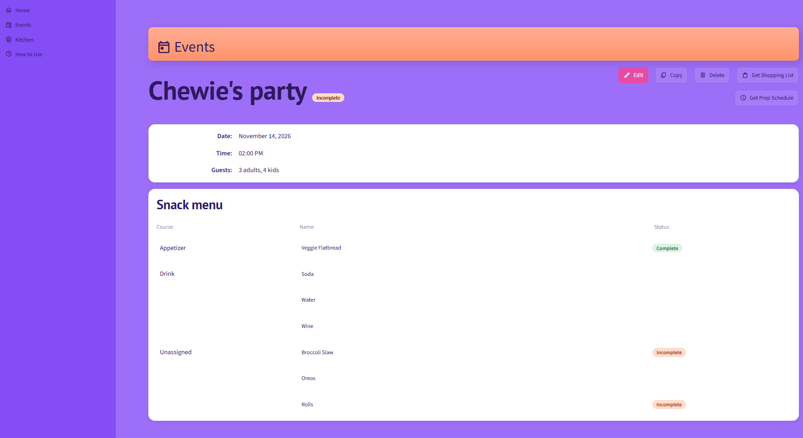
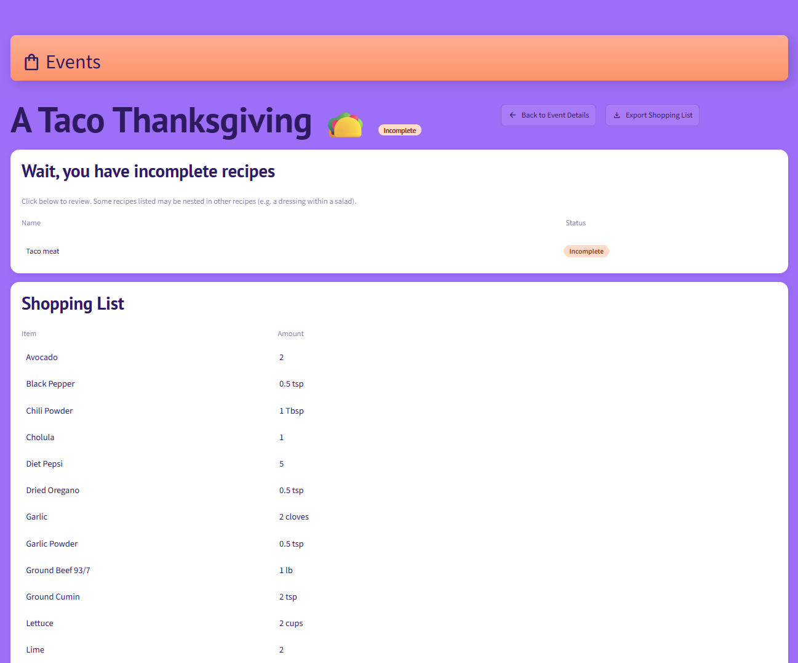
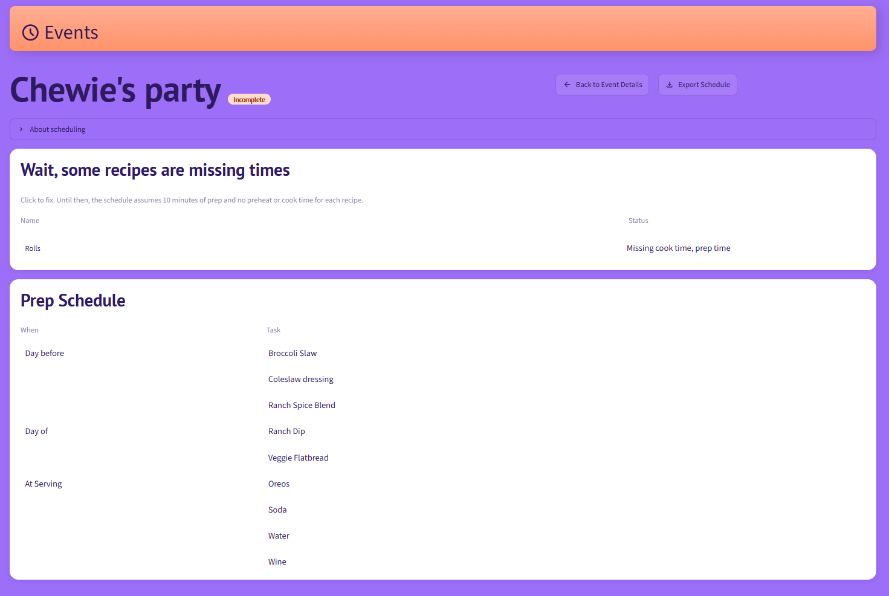
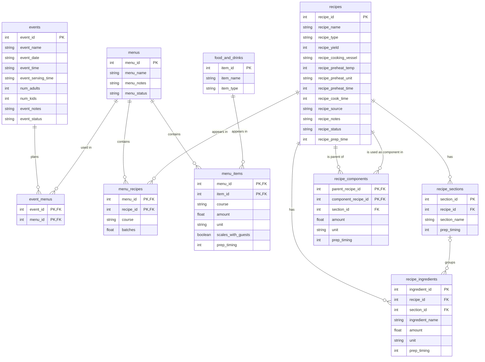

# Ready by Then
Ready by Then is a Python-based Streamlit application for party planning.  Create events, menus, custom recipes, and food and drink items.  Tag your family and friends' favorites to menus and events and get a shopping list and prep schedule scaled to your guest count and catered to when things should be prepared.


## Motivation
I love our big growing family and cooking for everyone when they visit, but it's a lot of planning!  "The kids are coming over for lunch this weekend" means cooking for ten with a full menu for the adults and chicken nuggets and fries for the littles, making sure we have everyone's favorite drinks stocked in the fridge, and a ton of planning on what to buy, when to prep what, and when I need to start cooking the day they come over.  I wanted an app that let me structure my recipes, menus, food and drink items, and events in a way where they were easy to use, repeatable, and would spit me out a shopping list and schedule without me slogging through recipes and planning everything out by hand.  Ready by Then is just that, the app that does the heavy lifting for me.

Now I can have a menu dedicated to the kids' favorite drinks tagged to all of my events.  With one click I can repeat our Thanksgiving from last year and know that my bases are covered.  I encourage you to check it out and see the Roadmap section of future enhancements the app would benefit from.


## Quick Start
### 1. Clone the repo and create a virtual environment
#### On macOS/Linux/WSL
```
git clone https://github.com/lorenrich/ready_by_then
cd ready_by_then
python3 -m venv .venv
source .venv/bin/activate
```

#### On Windows
```
git clone https://github.com/lorenrich/ready_by_then
cd ready_by_then
python -m venv .venv
.venv\Scripts\activate
```
If PowerShell blocks activation, run ```Set-ExecutionPolicy -Scope Process RemoteSigned``` and try again.

### 2. Install requirements
Make sure the virtual environment is activated (your prompt starts with .venv), then install the packages listed in ```requirements.txt```
```
pip install -r requirements.txt
```

### 3. Seed and launch the app
An example database has been provided. To run the app using the example database, from the project root run:

```
python seed.py
streamlit run app.py
```

To run the app with an empty database, run:
```
streamlit run app.py
```

App opens at http://localhost:8501.  Your data is saved in ```ready_by_then.db``` in the project directory.

If you wish to reset the database or if ```seed.py``` is run twice, you will be prompted to reset the database.
**--reset replaces the existing database and erases any events, menus, and recipes you have added**

To reset the database and remove all sample data, run:
```
python seed.py --reset
streamlit run app.py
```

If you don't wish to reset the database, proceed with:
```
streamlit run app.py
```

To stop the app run ```Ctrl``` + ```C```


## Usage


The shopping list will group items with like units across recipes (e.g. 2 cloves garlic, 3 cloves garlic) and scale with the number of batches assigned on the menu.  Additional food and drink items which don't require a recipe can be either a set amount or scaled with the guest count.



The schedule will summarize recipe components, sections, and ingredients and organize by "Day Before", "Day Of", and "At Serving" prep based on the user's selections.



Shopping lists and schedules are built when viewed and are not stored.  They can be exported to CSV.

Events, menus, recipes, and food and drink items can be repeated and adjusted to make the same party next year even easier.




### Known Limitations
In the shopping list, items will only be combined for like units (i.e. 2 cloves garlic in one recipe won't combine with 1 tsp garlic in another).  Units will only convert for US Customary measures including tsp, tbsp, and cups.

The prep schedule does not provide summary of estimated time to complete prep or suggestion of when to start cooking on "Day Of" prep and does not scale with number of batches.


## Roadmap
This app is v1.0 submitted for my Boot.dev capstone project which was scaled down considerably to meet a personal deadline.  Below are features tagged for future enhancements.

- 🚧 **Event Specs** - Scaling to accommodate events with "hearty eaters" and notifications for dietary restrictions.

- 🚧 **Upgraded Schedule** - Prep schedule based on event start/meal serving time to estimate when the host should start cooking and how long prep is estimated to take.

- 🚧 **Recipe Scraping and Uploading** - Users can submit URLs for their favorite recipes online or upload a photo of one and the app will translate the recipe data into the form for the user to review

- 🚧 **Custom Lists** - Build custom to-do lists for cleaning, decorations, and gifts linked to your prep schedule where you need it.

- 🚧 **Shareable Menu Template** -  When your event is potluck-style, invite your guests to sign up to bring something while ensuring you have a well-rounded menu.

- 🚧**Guest Lists** - Keep track of who's coming.

- 🚧 **Web Hosting** - An app always accessible which allows user accounts and securely stores your data in the cloud.

- 🚧 **Smart Alerts** - Notify the user when there isn't enough food on the menu for the number of guests, when the menu doesn't include drinks, or make suggestions based on the most frequently tagged recipes and items from the user.

- 🚧 **Chatbot Assistant** - Not sure what to do next?  Ask for help.


## Contact
Submit an issue here on GitHub.


## Contributing
I would love to collaborate on this project!  Contribute by forking the repo and opening pull requests to the ```main``` branch.  Please ensure your code is fully tested against the database.

